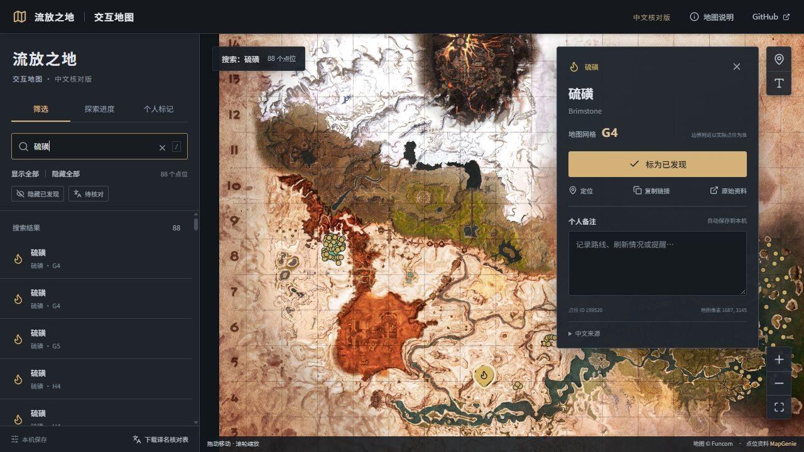
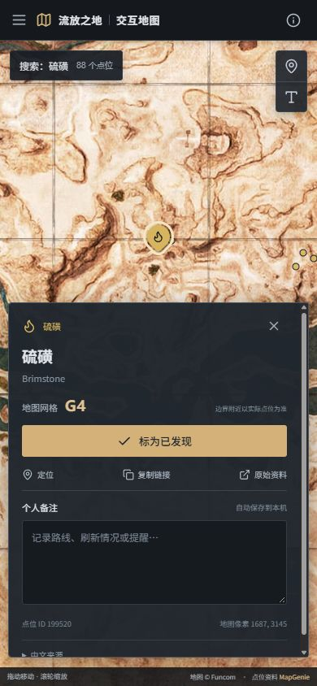

# 地图验收记录

日期：2026-10-15。最新代码只推送GitHub，未继续部署到Vercel。

## 数据与构建

- 2812个唯一点位ID、64个分类；原点位坐标与身份保留。
- 1786个点位使用此前已验收地图或本会话用户确认的中文；其余1026个点位保留英文。
- 待核对CSV共338行，包含未确认分类及点位名称，并标明使用语境。
- 六项测试通过：点位与分类完整性、译名来源、十个方尖碑投影控制点、备份校验、地图网格、筛选偏好恢复。
- TypeScript检查及Vite生产构建通过。构建提示单个JS包超过500kB，gzip约179kB；未视为阻止构建的错误。

## 浏览器交互

使用Codex内置浏览器检查本地源码版本，未使用其他浏览器自动化绕过参考站的访问限制。

- `A11`搜索返回13个点位，结果中显示对应网格；地底之王征服者配方详情显示A11。
- “硫磺”搜索返回88个点位；示例ID199520显示硫磺、英文Brimstone及G4网格。
- 隐藏全部后只启用方尖碑，刷新仍显示10个点位。
- 既有功能已检查：已发现进度和备注刷新后保留、点位深链接与复制、个人标记添加/打开/删除、备份导入导出；测试数据已清理。
- 手机390×844检查选中图标与详情面板不重叠：示例标记底部约311px，详情顶部约372px。切换屏幕尺寸时会重新定位当前选中点位。
- 手机全图缩放可容纳完整354×354底图，未超过390px视口宽度。筛选抽屉可打开、关闭。

## 视觉复核

桌面1280×720、手机390×844，截图由内置浏览器保存，并用本地图片查看工具复核。

1. 结构：左侧分类/搜索，主地图画布，右侧桌面详情与手机底部详情；未增加营销首页。
2. 地图：原始4000×4000底图，保持纵横比、网格及原始图像色彩；无额外色调覆盖。
3. 字体：中文名称、英文身份、分类计数及个人备注层级可区分；界面文字为原生HTML。
4. 颜色：深色工具界面与已有金色选中状态保持一致；九种资源点使用可区分颜色，缩小时标记减少遮挡。
5. 操作：缩放、全图、个人标记和名称显示按钮保留；详情与地图工具未互相覆盖。
6. 中文：制甲匠、随机奴隶及九种资源名称来自用户确认。Named Thrall等未确认标题不自动套用分类译名。新增网格提示及偏好保存属于明确的功能改进。

参考为用户指定的MapGenie界面及此前保存的页面结构资料。参考站浏览器访问受站点安全策略阻止，因此没有原站截图/生成概念图作为像素级对照，不能声称已完成原站像素级复刻。未导入原站账号、评论、付费功能、长篇说明和说明图片。

当前预览：

